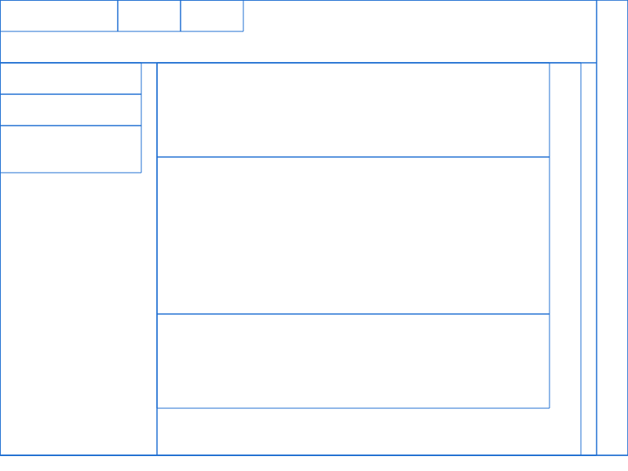

# Blink(e)rs

An experimental web rendering engine in Rust, focused on the **DOM → style → layout** pipeline. It takes the single-threaded, constraint-driven layout model of Chromium's LayoutNG as its reference design and rebuilds it around a flat, arena-allocated DOM.

> **Status: pre-alpha, Phase 1 complete (proof of concept).** The engine parses HTML and CSS, matches selectors, lays out block and inline-block-style boxes, and writes a wireframe PNG of the resulting fragments. Text layout, margins/padding, wrapping, and most of CSS are not implemented yet. See [Current limitations](#current-limitations) and the [Roadmap](#roadmap).
>
> This is an independent project. It is not affiliated with Google or the Chromium project; Blink and LayoutNG are used as architectural references only.



*Wireframe of the layout fragments produced from [`assets/test.html`](assets/test.html) and [`assets/test.css`](assets/test.css).*

## Goals

- Build the layout and DOM core of a browser engine, not everything around it. Commodity pieces (HTML tokenization/tree construction via `html5ever`, planned V8 and Skia integration) are reused rather than rewritten.
- Use Rust's ownership model to design the tree structures instead of fighting it: no raw-pointer trees, no `Rc<RefCell<_>>` graphs.
- Stay close enough to LayoutNG's concepts (constraint spaces in, fragments out) that its public design documents remain a useful guide.

## Pipeline

```
 HTML string ──► blink_html ──► Dom (arena) ───────────┐
                (html5ever)                            │
                                                       ▼
 CSS string  ──► blink_css  ──► CSSStyleSheet ──► blink_layout ──► FragmentArena ──► blink_render ──► output.png
                                                 (style + layout)
```

## Workspace

| Crate | Responsibility |
|---|---|
| `blink_dom` | Arena-allocated DOM tree, tag table, attribute storage |
| `blink_html` | HTML parsing into the arena DOM using `html5ever` |
| `blink_css` | CSS tokenizer/parser and the `CSSStyleSheet`/`CSSStyleRule` model |
| `blink_layout` | Selector matching, cascade, `ConstraintSpace`, layout, fragment tree |
| `blink_render` | Turns the fragment tree into pixels |
| `blink_shell` | Executable that wires the crates together |
| `blink_core` | Shared primitives, notably the typed `Id<T>` handle |
| `xtask` | Developer automation |

## Design

### Arena DOM (`blink_dom`)

- Nodes live in a single `Vec<DomNode>` and are addressed by `DomNodeId`, a typed, 1-based, non-zero `u32` handle. `Option<DomNodeId>` is therefore 4 bytes.
- Tree structure uses intrusive links: each node stores `parent` and `next_sibling`, and elements store `first_child`. There is no per-node `Vec<Child>`.
- `NodeKind` is `Element`, `Text` or `EmptyLeaf` (`<br>`, `<hr>`).
- Tag names are `u8` indices into a sorted static table of HTML tags: O(log n) to look up by name, O(1) to get the name back.
- Attributes are stored out of line and referenced from element nodes, so text nodes and attribute-less elements pay nothing for them.
- Two storage layouts sit behind the `dense-core` Cargo feature. [`benches/dom_comparison.rs`](benches/dom_comparison.rs) compares them. Both must pass the test suite.

### Style (`blink_layout::style`)

- Selectors: type, `#id`, `.class`, compound selectors, and the descendant combinator.
- Cascade: matching rules are ordered by specificity, with source order breaking ties. Supported properties: `display` (`block`, `inline`, `none`), `width` and `height` (`px`).
- A small built-in user-agent default maps tags to a default `display` (for example `div` → block, `head` → none).

### Layout (`blink_layout::engine`)

- Layout is a recursive pass over the DOM. For each node it computes style, prunes `display: none`, resolves size from the parent's `ConstraintSpace`, lays out children, then resolves any auto height.
- Block children stack vertically. Inline children flow left to right on a line whose height is the tallest child. Auto-width blocks take the available width; auto-width inline boxes shrink-wrap their content.
- Output is a `FragmentArena`: a flat `Vec<LayoutFragment>` with `first_child`/`next_sibling` links, mirroring the DOM's topology. Fragments are built parent-relative and then converted to absolute coordinates in a final pass.
- Fragments are **not yet immutable**. They are patched while layout runs. Making them immutable is a Phase 2 goal.

## Current limitations

Known gaps, many of which are good places to start contributing (see [CONTRIBUTING.md](CONTRIBUTING.md)):

- Text nodes are skipped, so there is no text layout, shaping, or whitespace handling.
- The parser can emit several adjacent text nodes for one run of text; they are not merged.
- `display: inline` behaves like `inline-block` (width and height apply). Real inline formatting does not exist yet.
- No line wrapping: inline children that exceed the available width overflow instead of wrapping.
- An auto-width inline box containing only block children collapses to zero width.
- No margin, padding, border, `position`, floats, or flexbox.
- No property inheritance. Only `px` lengths are parsed.
- No child, sibling or attribute selectors, no pseudo-classes, no `!important`.
- Unknown `display` values fall back to `inline`. Unknown tag names currently map to tag index 0.
- `blink_render` currently draws fragment boundaries, not painted content.

## Building and running

```sh
cargo build --workspace
cargo run -p blink_shell     # lays out assets/test.html with assets/test.css and writes output.png
```

## Testing

```sh
cargo test --workspace                          # default DOM layout
cargo test --workspace --features blink_dom/dense-core   # dense-core DOM layout
cargo bench                                     # DOM storage comparison (see run_bench.sh)
```

Unit tests cover selector matching, specificity, descendant chains, length parsing, and attribute lookup across text and `<br>` nodes. A golden test asserting fragment rectangles for `assets/test.html` is planned.

## Roadmap

### Phase 1: Linear static pipeline (complete)

- [x] HTML parser producing an arena DOM
- [x] Selector matching and specificity-based cascade
- [x] Block and inline-block box layout with `display: none` pruning
- [x] Fragment tree rendered to an image

### Phase 1.5: Text and inline flow

- [ ] Merge adjacent text nodes in the tree builder
- [ ] Whitespace collapsing and text fragments
- [ ] Line breaking and wrapping
- [ ] Rename the current `Inline` to `InlineBlock`; introduce true inline layout
- [ ] Golden tests for all fixtures in `assets/`

### Phase 2: LayoutNG-style architecture

- [ ] Immutable `ConstraintSpace` passed down the tree
- [ ] Immutable physical fragment tree
- [ ] Margin, padding, and border (box model)
- [ ] Incremental layout and caching driven by invalidation boundaries

### Phase 3: Binding and reactive layer

- [ ] Bindings between V8 objects and arena DOM nodes
- [ ] Invalidation manager connecting DOM mutation to restyle, relayout, and repaint
- [ ] Single-threaded event loop for timers, input and layout frames

Skia-backed painting and text shaping (in `blink_render`) will land alongside Phases 1.5 and 2.

## Contributing

Contributions are welcome, especially on the items in [Current limitations](#current-limitations). Read [CONTRIBUTING.md](CONTRIBUTING.md) first.

## License

See [LICENSE](LICENSE).