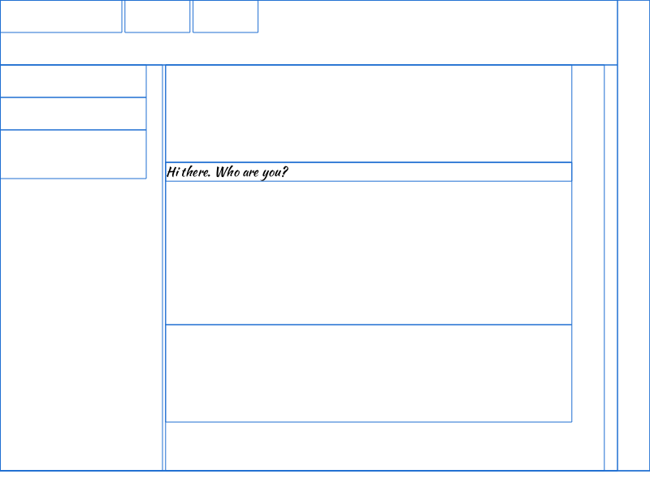

# Blink(e)rs

An experimental web rendering engine in Rust, focused on the **DOM → style → layout** pipeline. It takes the single-threaded, constraint-driven layout model of Chromium's LayoutNG as its reference design and rebuilds it around a flat, arena-allocated DOM.

> **Status: pre-alpha, Phases 1 and 1.5 complete (proof of concept).** The engine supports block and inline layout, basic text measurement, whitespace collapsing, text fragments, line breaking and wrapping, and basic glyph rasterization. It produces rendered PNG output through the layout and rendering pipeline. Full-text shaping and most CSS features remain unimplemented. See [Current limitations](#current-limitations) and the [Roadmap](#roadmap).
>
> This is an independent project. It is not affiliated with Google or the Chromium project; Blink and LayoutNG are used as architectural references only.



*Wireframe of the layout fragments produced from [`assets/test.html`](assets/test.html) and [`assets/test.css`](assets/test.css).*

## Goals

- Build the layout and DOM core of a browser engine, not everything around it. Commodity pieces (HTML tokenization/tree construction via `html5ever`, planned V8 and Skia integration) are reused rather than rewritten.
- Use Rust's ownership model to design the tree structures instead of fighting it: no raw-pointer trees, no `Rc<RefCell<_>>` graphs.
- Stay close enough to LayoutNG's concepts (constraint spaces in, fragments out) that its public design documents remain a useful guide.

## Pipeline

```
 HTML string ──► blink_html ──► Dom (arena) ───────────┐                 ┌─────────► blink_svg ──► output.svg
                (html5ever)                            │                 │
                                                       ▼                 │
 CSS string  ──► blink_css  ──► CSSStyleSheet ──► blink_layout ──► FragmentArena ──► blink_render ──► output.png
                                                 (style + layout)        │
                                                                         │
                                                                         └─────────► blink_figma ──► output.json
```

## Workspace

| Crate          | Responsibility                                                       |
|----------------|----------------------------------------------------------------------|
| `blink_dom`    | Arena-allocated DOM tree, tag table, attribute storage               |
| `blink_html`   | HTML parsing into the arena DOM using `html5ever`                    |
| `blink_css`    | CSS tokenizer/parser and the `CSSStyleSheet`/`CSSStyleRule` model    |
| `blink_layout` | Selector matching, cascade, `ConstraintSpace`, layout, fragment tree |
| `blink_render` | Turns the fragment tree into pixels                                  |
| `blink_shell`  | Executable that wires the crates together                            |
| `blink_core`   | Shared primitives, notably the typed `Id<T>` handle                  |
| `xtask`        | Developer automation (planned)                                       |

## Design

### Arena DOM (`blink_dom`)

- Nodes live in a single `Vec<DomNode>` and are addressed by `DomNodeId`, a typed, 1-based, non-zero `u32` handle. `Option<DomNodeId>` is therefore 4 (four) bytes.
- Tree structure uses intrusive links: each node stores `parent` and `next_sibling`, and elements store `first_child`. There is no per-node `Vec<Child>`.
- `NodeKind` is `Element`, `Text` or `EmptyLeaf` (`<br>`, `<hr>`).
- Tag names are `u8` indices into a sorted static table of HTML tags: O(log n) to look up by name, O(1) to get the name back.
- Attributes are stored out of line and referenced from element nodes, so text nodes and attribute-less elements pay nothing for them.
- Nodes are stored in a `Vec<DomNode>`; attributes and character data are stored out-of-line in separate typed `SlotStore`s.

### Style (`blink_layout::style`)

- Selectors: type, `#id`, `.class`, compound selectors, and the descendant combinator.
- Cascade: matching rules are ordered by specificity, with source order breaking ties. Supported properties: `display` (`block`, `inline`, `inline-block`, `none`), `width` and `height` (`px`).
- A small built-in user-agent default maps tags to a default `display` (for example `div` → block, `head` → none).

### Layout (`blink_layout::engine`)

- Layout is a recursive pass over the DOM. For each node it computes style, prunes `display: none`, resolves size from the parent's `ConstraintSpace`, lays out children, then resolves any auto height.
- Block children stack vertically. Inline children flow left to right on a line whose height is the tallest child. Auto-width blocks take the available width; auto-width inline boxes shrink-wrap their content.
- Output is a `FragmentArena`: a flat `Vec<LayoutFragment>` with `first_child`/`next_sibling` links, mirroring the DOM's topology. Fragments are built parent-relative and then converted to absolute coordinates in a final pass.
- Fragments are **not yet immutable**. They are patched while the layout runs. Making them immutable is a Phase 2 goal.
- Unsupported `display` declarations are ignored.
- Unknown tag names are registered dynamically, but generic tag-name lookup currently falls back to `div`.

### Rendering (`blink_render`)
- Basic glyph rasterization and fragment rendering are supported.

## Current limitations

Known gaps, many of which are good places to start contributing (see [CONTRIBUTING.md](CONTRIBUTING.md)):

- Full-text shaping, kerning, and ligatures are not implemented.
- Text wraps at supported whitespace boundaries; comprehensive Unicode line breaking and hyphenation are not implemented.
- The inline formatting model is still incomplete.
- Glyphs are rasterized individually rather than through a full text-shaping pipeline.
- No margin, padding, border, `position`, floats, or flexbox.
- No property inheritance. Only `px` lengths are parsed.
- No child, sibling or attribute selectors, no pseudo-classes, no `!important`.

## Building and running

```sh
cargo build --workspace
cargo run -p blink_shell     # lays out assets/test.html with assets/test.css and writes output.png
```

## Testing

```sh
cargo test --workspace                          # default DOM layout
```

Previously, the `dense-core` feature was used to test the alternative DOM storage layout. It is now the default and has been mostly removed from the codebase. The remaining `dense-core` feature flag is retained but serves as an inert compatibility flag and can be, thus, ignored. For potential future testing of this feature, it can be run with:

```sh
cargo test --workspace --features blink_dom/dense-core
```

Unit tests cover selector matching, specificity, descendant chains, length parsing, and attribute lookup across text and `<br>` nodes.

The golden layout tests cover five fixtures: `basic`, `inline_wrapping`,
`mixed_block_inline`, `nested_inline`, and `display_none`.

Run them with:

```sh
cargo test -p blink_layout --test golden_layout
```

If you change the layout engine, update the expected rectangles in `crates/blink_layout/tests/fixtures/` and commit them. A page that renders "about right" is not a test.
To regenerate the expected rectangles for all fixtures, run:

```sh
BLESS=1 cargo test -p blink_layout --test golden_layout
```

## Roadmap

### Phase 1: Linear static pipeline (complete)

- [x] HTML parser producing an arena DOM
- [x] Selector matching and specificity-based cascade
- [x] Block and inline-block box layout with `display: none` pruning
- [x] Fragment tree rendered to an image

### Phase 1.5: Text and inline flow

- [x] Merge adjacent text nodes in the tree builder
- [x] Whitespace collapsing and text fragments
- [x] Line breaking and wrapping
- [x] Rename the current `Inline` to `InlineBlock`; introduce true inline layout
- [x] Golden tests for all fixtures in `crates/blink_layout/tests/fixtures/`

### Phase 2: Serialization & Alternate Render Targets

- [x] Create `blink_svg` crate to map layout fragments to declarative SVG `<rect>` and `<text>` elements.
- [ ] ~~Create `blink_figma` crate to serialize fragments into Figma's JSON schema (absolute positioning).~~
- [x] Abstract a standard `Renderer` or `Backend` trait to decouple the FragmentArena from `blink_render`.
- [ ] ~~Experimental: Map CSS constraints directly to Figma Auto Layout properties.~~

### Phase 3: LayoutNG-style architecture

- [ ] Immutable `ConstraintSpace` passed down the tree
- [x] Immutable physical fragment tree
- [ ] Margin, padding, and border (box model)
- [ ] Incremental layout and caching driven by invalidation boundaries

### Phase 4: Binding and reactive layer

- [ ] Bindings between V8 objects and arena DOM nodes
- [ ] Invalidation manager connecting DOM mutation to restyle, relayout, and repaint
- [ ] Single-threaded event loop for timers, input and layout frames

Full text shaping and a more complete painting pipeline remain future work.

## Contributing

Contributions are welcome, especially on the items in [Current limitations](#current-limitations). Read [CONTRIBUTING.md](CONTRIBUTING.md) first.

## License

See [LICENSE](LICENSE).