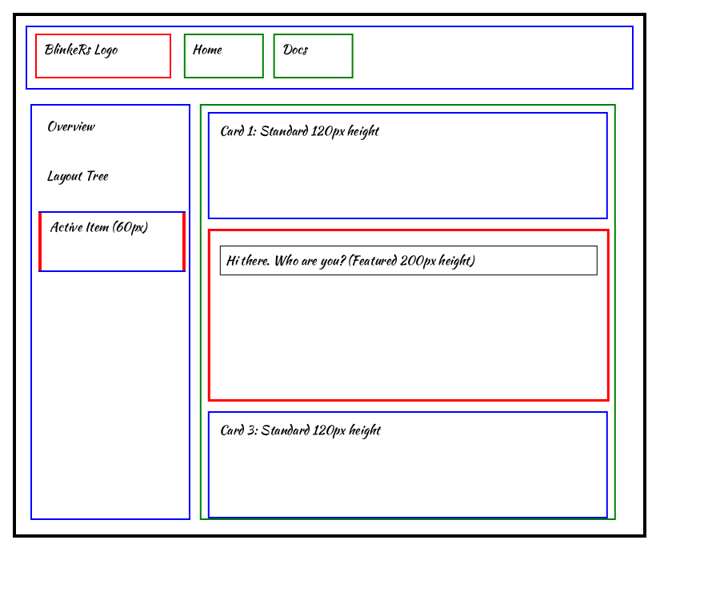

<div align="center">

# Blink(e)rs

**An experimental web rendering engine in Rust, focused on the DOM → style → layout pipeline.**

<p>
  <picture>
    <source media="(prefers-color-scheme: dark)" srcset="images/mdr/rust-dark-536849d6.svg" />
    <source media="(prefers-color-scheme: light)" srcset="images/mdr/rust-light-73469f47.svg" />
    
  </picture>
  <a href="https://github.com/Powerisinschool/blink-rs/actions">
    <picture>
      <source media="(prefers-color-scheme: dark)" srcset="images/mdr/ci-status-dark-446261f2.svg" />
      <source media="(prefers-color-scheme: light)" srcset="images/mdr/ci-status-light-bdd48e91.svg" />
      
    </picture>
  </a>
  <a href="https://github.com/Powerisinschool/blink-rs/blob/main/LICENSE">
    <picture>
      <source media="(prefers-color-scheme: dark)" srcset="images/mdr/license-dark-0c6920aa.svg" />
      <source media="(prefers-color-scheme: light)" srcset="images/mdr/license-light-ab7bbbd8.svg" />
      
    </picture>
  </a>
  <a href="https://github.com/Powerisinschool/blink-rs">
    <picture>
      <source media="(prefers-color-scheme: dark)" srcset="images/mdr/repository-dark-84e77b74.svg" />
      <source media="(prefers-color-scheme: light)" srcset="images/mdr/repository-light-ebcb7185.svg" />
      
    </picture>
  </a>
</p>

</div>

---

Blink(e)rs takes the single-threaded, constraint-driven layout model of Chromium's LayoutNG as its reference design and rebuilds it around a flat, arena-allocated DOM.

> **Status: pre-alpha, Phases 1, 1.5 and 2 complete; Phase 3 in progress (proof of concept).** The engine supports block and inline layout with the CSS box model (margin, padding and border), basic text measurement, whitespace collapsing, text fragments, line breaking and wrapping, and basic glyph rasterization. It renders to PNG with painted borders, and to SVG. Full text shaping and most CSS features remain unimplemented. See [Current limitations](#current-limitations) and the [Roadmap](#roadmap).
>
> This is an independent project. It is not affiliated with Google or the Chromium project; Blink and LayoutNG are used as architectural references only.



*Standard render of [`assets/test.html`](assets/test.html) and [`assets/test.css`](assets/test.css). Run with `DEBUG_WIREFRAMES=1` to overlay fragment outlines.*

---

### Goals

- Build the layout and DOM core of a browser engine, not everything around it. Commodity pieces (HTML tokenization/tree construction via `html5ever`, planned V8 and Skia integration) are reused rather than rewritten.
- Use Rust's ownership model to design the tree structures instead of fighting it: no raw-pointer trees, no `Rc<RefCell<_>>` graphs.
- Stay close enough to LayoutNG's concepts (constraint spaces in, fragments out) that its public design documents remain a useful guide.

---

### Pipeline

```
 HTML string ──► blink_html ──► Dom (arena) ───────────┐                 ┌─────────► blink_svg ──► output.svg
                (html5ever)                            │                 │
                                                       ▼                 │
 CSS string  ──► blink_css  ──► CSSStyleSheet ──► blink_layout ──► FragmentArena ──► blink_render ──► output.png
                                                 (style + layout)   + StyleCache
```

---

### Workspace

| Crate          | Responsibility                                                                     |
|----------------|------------------------------------------------------------------------------------|
| `blink_dom`    | Arena-allocated DOM tree, tag table, attribute storage                             |
| `blink_html`   | HTML parsing into the arena DOM using `html5ever`                                  |
| `blink_css`    | CSS tokenizer/parser and the `CSSStyleSheet`/`CSSStyleRule` model                  |
| `blink_layout` | Selector matching, cascade, `StyleCache`, `ConstraintSpace`, layout, fragment tree |
| `blink_render` | Turns the fragment tree into pixels, including border painting                     |
| `blink_svg`    | Maps layout fragments to SVG `<rect>` and `<text>` elements                        |
| `blink_shell`  | Executable that wires the crates together                                          |
| `blink_core`   | Shared primitives, notably the typed `Id<T>` handle and `Generation`               |
| `xtask`        | Developer automation (planned)                                                     |

---

### Design

#### Arena DOM (`blink_dom`)

- Nodes live in a single `Vec<DomNode>` and are addressed by `DomNodeId`, a typed, 1-based, non-zero `u32` handle. `Option<DomNodeId>` is therefore 4 (four) bytes.
- Tree structure uses intrusive links: each node stores `parent` and `next_sibling`, and elements store `first_child`. There is no per-node `Vec<Child>`.
- `NodeKind` is `Element`, `Text` or `EmptyLeaf` (`<br>`, `<hr>`).
- Tag names are `u8` indices into a sorted static table of HTML tags: O(log n) to look up by name, O(1) to get the name back.
- Attributes are stored out of line and referenced from element nodes, so text nodes and attribute-less elements pay nothing for them.
- Nodes are stored in a `Vec<DomNode>`; attributes and character data are stored out-of-line in separate typed `SlotStore`s.

#### Style (`blink_layout::style`)

- Split into `cascade`, `matching` and `types` modules.
- Selectors: type, `#id`, `.class`, compound selectors, and the descendant combinator.
- Cascade: matching rules are ordered by specificity, with source order breaking ties.
- Supported properties:
  - `display` (`block`, `inline`, `inline-block`, `none`)
  - `width` and `height` (`px`), which set the content box
  - `margin`, `padding` and their per-side longhands, with 1–4 value expansion. Margins may be negative; padding is clamped to 0.
  - `border`, `border-width`, `border-style`, `border-color` and their per-side longhands. Widths are clamped to 0. Styles: `none`, `hidden`, `solid`. Colors: hex (3, 6 or 8 digits), the CSS 2.1 named colors, `transparent`, `currentcolor`.
- Each node's computed style is computed once and stored in a shared `StyleCache`. Entries are checked against the node's generation, so they stay valid as the DOM changes. Fragments refer to their style by `ComputedStyleId` rather than owning a copy.
- A small built-in user-agent default maps tags to a default `display` (for example `div` → block, `head` → none).

#### Layout (`blink_layout::layout`)

- Layout state lives in a `LayoutContext<M: TextMeasurer>`, which holds the DOM, stylesheet, text measurer and style cache. `build_layout_tree` and `layout_node` are methods on it.
- Layout is a recursive pass over the DOM. For each node it looks up the computed style, prunes `display: none`, resolves size from the parent's `ConstraintSpace`, lays out children, then resolves any auto height.
- Box model: each fragment's rect is its border box. Children are placed inside the parent's padding and border. `width`/`height` size the content box.
- Block children stack vertically, separated by their top and bottom margins. Inline children flow left to right on a line whose height is the tallest child; inline-block margins are counted when lines are measured and broken. Auto-width blocks take the available width; auto-width inline boxes shrink-wrap their content.
- Inline layout is split into `collect`, `prepare`, `line_breaker` and `atomic` stages under `layout/inline/`.
- Output is a `FragmentArena`: a flat `Vec<LayoutFragment>` with `first_child`/`next_sibling` links, mirroring the DOM's topology. The arena stores fragments and their structural relationships.
- Fragments are constructed with parent-relative coordinates. Absolute coordinates are resolved during fragment traversal, not by modifying the layout tree.
- Fragment geometry and tree relationships are immutable after construction.
- Unsupported `display` declarations are ignored.
- Unknown tag names are registered dynamically, but generic tag-name lookup currently falls back to `div`.

#### Rendering (`blink_render`)

- Basic glyph rasterization and fragment rendering are supported.
- Borders are filled per side using the computed border colors (default black).
- Fragment wireframes are drawn only when `DEBUG_WIREFRAMES` is set.
- `render_to_png_with_options` takes the fragment arena, the `StyleCache`, the output size and path, and a `RenderOptions` value (font, font size, debug wireframes).

---

### Current limitations

Known gaps, many of which are good places to start contributing (see [CONTRIBUTING.md](CONTRIBUTING.md)):

- Full-text shaping, kerning, and ligatures are not implemented.
- Text wraps at supported whitespace boundaries; comprehensive Unicode line breaking and hyphenation are not implemented.
- The inline formatting model is still incomplete.
- Glyphs are rasterized individually rather than through a full text-shaping pipeline.
- No margin collapsing: adjacent vertical margins add together.
- No `box-sizing`; `width` and `height` always set the content box.
- No `auto` margins.
- Only `px` lengths are parsed (no percentages, `em`, etc.).
- Only `none`, `hidden` and `solid` borders. Other styles (`dashed`, `dotted`, `double`) make the whole declaration invalid.
- No `position`, floats, or flexbox.
- No property inheritance.
- No child, sibling or attribute selectors, no pseudo-classes, no `!important`.

---

### Retrieving the source code

```sh
git clone https://github.com/Powerisinschool/blink-rs.git
cd blink-rs
```

### Building and running

```sh
cargo build --workspace
cargo run -p blink_shell                     # lays out assets/test.html with assets/test.css and writes a 900×750 output.png
DEBUG_WIREFRAMES=1 cargo run -p blink_shell  # same, with fragment outlines
```

---

### Testing

```sh
cargo test --workspace                          # default DOM layout
```

Previously, the `dense-core` feature was used to test the alternative DOM storage layout. It is now the default and has been mostly removed from the codebase. The remaining `dense-core` feature flag is retained but serves as an inert compatibility flag and can be, thus, ignored. For potential future testing of this feature, it can be run with:

```sh
cargo test --workspace --features blink_dom/dense-core
```

Unit tests cover selector matching, specificity, descendant chains, length parsing, and attribute lookup across text and `<br>` nodes.

The golden layout tests cover six fixtures: `basic`, `inline_wrapping`, `mixed_block_inline`, `nested_inline`, `display_none`, and `box_model`. Run them with:

```sh
cargo test -p blink_layout --test golden_layout
```

If you change the layout engine, update the expected rectangles in `crates/blink_layout/tests/fixtures/` and commit them. A page that renders "about right" is not a test. To regenerate the expected rectangles for all fixtures, run:

```sh
BLESS=1 cargo test -p blink_layout --test golden_layout
```

---

### Roadmap

#### Phase 1: Linear static pipeline (complete)

- [x] HTML parser producing an arena DOM
- [x] Selector matching and specificity-based cascade
- [x] Block and inline-block box layout with `display: none` pruning
- [x] Fragment tree rendered to an image

#### Phase 1.5: Text and inline flow (complete)

- [x] Merge adjacent text nodes in the tree builder
- [x] Whitespace collapsing and text fragments
- [x] Line breaking and wrapping
- [x] Rename the current `Inline` to `InlineBlock`; introduce true inline layout
- [x] Golden tests for all fixtures in `crates/blink_layout/tests/fixtures/`

#### Phase 2: Serialization & Alternate Render Targets (complete)

- [x] Create `blink_svg` crate to map layout fragments to declarative SVG `<rect>` and `<text>` elements.
- [ ] ~~Create `blink_figma` crate to serialize fragments into Figma's JSON schema (absolute positioning).~~
- [x] Abstract a standard `Renderer` or `Backend` trait to decouple the FragmentArena from `blink_render`.
- [ ] ~~Experimental: Map CSS constraints directly to Figma Auto Layout properties.~~

#### Phase 3: LayoutNG-style architecture (in progress)

- [x] Immutable `ConstraintSpace` passed down the tree
- [x] Immutable physical fragment tree
- [x] Margin, padding, and border (box model)
- [ ] Incremental layout and caching driven by invalidation boundaries

#### Phase 4: Binding and reactive layer

- [ ] Bindings between V8 objects and arena DOM nodes
- [ ] Invalidation manager connecting DOM mutation to restyle, relayout, and repaint
- [ ] Single-threaded event loop for timers, input and layout frames

Full text shaping and a more complete painting pipeline remain future work.

---

### Contributing

Contributions are welcome, especially on the items in [Current limitations](#current-limitations). Read [CONTRIBUTING.md](CONTRIBUTING.md) first.

### License

Blink(e)rs is released under the [MIT License](LICENSE).
